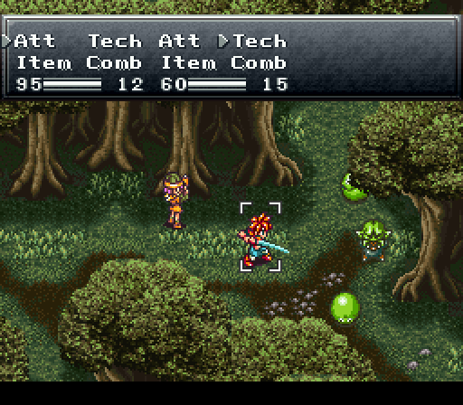
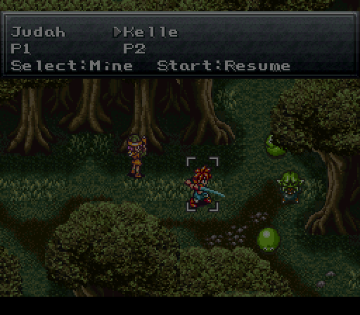
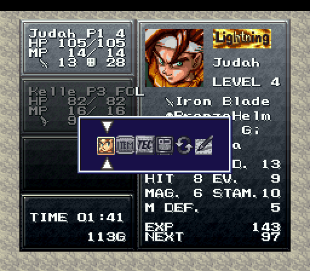

# Chrono Trigger: 3 Player

Play Chrono Trigger on the couch with two friends. Each player runs their own
party member in battle, walks around on their own in towns and dungeons, and
can open the menu for their character. There's also an optional patch that
puts the anime cutscenes from the PlayStation release back into the SNES game.

Works with the original **Chrono Trigger (USA)** and with **Chrono Trigger Plus**.

<p align="center">
  
  
  
</p>

**Contents:** [Downloads](#downloads) · [Installing](#installing) ·
[Cutscenes (FMV)](#cutscenes-fmv) · [How to play](#how-to-play) ·
[Menus and buttons](#menus-and-buttons) · [FAQ](#faq) · [Building](#building-from-source) ·
[Credits](#credits)

---

## Downloads

Grab the patches from the [Releases page](../../releases/latest). There are
three flavours for each game:

| Patch | What you get |
|---|---|
| **3 Player** | 3-player co-op |
| **FMV** | The anime cutscenes and a video gallery (single player) |
| **3 Player + FMV** | Both |

Files starting `Chrono-Trigger-` are for the original game. Files starting
`CT-Plus-` are for Chrono Trigger Plus.

All of them include MSU-1 support, so you can add CD-quality music if you have
an MSU-1 music pack. Without one, the game plays its normal music.

> [!NOTE]
> No game files are included here. You need your own copy of the game.

## Installing

### 1. Check your ROM

| Game | Size | CRC32 |
|---|---|---|
| Chrono Trigger (USA) | 4,194,304 bytes | `2D206BF7` |
| Chrono Trigger Plus (CTSE 3.0) | 6,291,456 bytes | `DB9AB142` |

If your original Chrono Trigger file is 4,194,816 bytes, it has a 512-byte
copier header. Remove it first (most patchers have a tick box for this, or use
a header remover).

For the CT+ patches, patch your **CT+ ROM**, not the original game.

### 2. Apply the patch

The easiest way is [Rom Patcher JS](https://www.marcrobledo.com/RomPatcher.js/)
in your browser:

1. Open the site.
2. Pick your ROM under **ROM file**.
3. Pick the `.bps` file under **Patch file**.
4. Click **Apply patch** and save the result.

[Floating IPS](https://github.com/Alcaro/Flips) on Windows works too:
**Apply Patch**, pick the `.bps`, pick your ROM, then save the new file.

Give the patched ROM a short, simple name such as `Chrono Trigger 3P.sfc`. If you
add music or cutscenes, their files have to match this name.

### 3. Set up your emulator

You need an emulator with MSU-1 support. This has been tested in:

- **RetroArch** with the **Snes9x** core (Windows and Android handhelds)
- **Mesen 2**

For three players you need a **multitap** in port 2:

- **RetroArch:** *Quick Menu → Controls → Port 2 Controls → Device Type →
  Multitap*. Players 2 to 5 now come in through port 2.
- **Mesen 2:** *Settings → Input → Player 2 → Multitap*.

> [!TIP]
> RetroArch uses **Select** as its hotkey button by default, and Select + Start
> closes the emulator. This mod uses Select a lot, so turn on
> *Settings → Input → Hotkeys → Confirm Quit*, or move the hotkey to another button.

### 4. Optional: music

Put a Chrono Trigger MSU-1 music pack in the same folder as the ROM, with its
files renamed to match: `Chrono Trigger 3P-1.pcm`, `Chrono Trigger 3P-2.pcm`
and so on. Some emulators also need a `Chrono Trigger 3P.msu` file. An empty
one is fine if you only want music. The FMV step below makes the real one.

## Cutscenes (FMV)

The FMV patches play the PlayStation release's ten anime cutscenes: the
opening on the title screen, seven story scenes, and two ending clips. I can't
share the video files, so you make them yourself from your own copy of
**Final Fantasy Chronicles** (the USA PlayStation release that includes Chrono Trigger).
It takes about five minutes.

**You'll need:**

- The disc as a `.bin` file (with its `.cue`), e.g.
  `Final Fantasy Chronicles - Chrono Trigger (USA).bin`
- [Python 3](https://www.python.org/downloads/). Tick *Add python.exe to PATH*
  when installing.
- [ffmpeg](https://ffmpeg.org/download.html)

On Windows, the quickest way to get both is to open a Command Prompt and run:

```
winget install Python.Python.3.12
winget install Gyan.FFmpeg
```

Then close the Command Prompt so the new programs are picked up.

### Windows: drag and drop

1. Download this repository (**Code → Download ZIP**) and unzip it.
2. Open the `fmv_kit` folder.
3. Drag your `.bin` file onto **`MAKE_VIDEOS.bat`**.
4. When it asks, type your patched ROM's name without the extension, e.g.
   `Chrono Trigger 3P`, and press Enter.
5. Wait for it to finish (a few minutes).
6. Move the new files from `fmv_kit` into the folder with your ROM:
   - `Chrono Trigger 3P.msu` (about 390 MB)
   - `Chrono Trigger 3P-100.pcm` through `Chrono Trigger 3P-109.pcm`

That's it. Start the game and the opening plays on the title screen.

### Mac / Linux / by hand

```
pip install numpy pillow
cd fmv_kit
python make_videos.py "path/to/Final Fantasy Chronicles - Chrono Trigger (USA).bin" "Chrono Trigger 3P"
```

Then copy the `.msu` and `-100.pcm` to `-109.pcm` files next to your ROM, as above.

### Playing on a handheld or another device

Make the files on a PC, then copy them over. The ROM, the `.msu` and all the
`.pcm` files (music and video) go in **the same folder**, and their names must
match the ROM's name exactly.

### The video gallery

On the save-file screen the top line reads **New Game (Y:FMV)**. Press **Y**
to watch every cutscene in order. **Start** or **B** skips one. You can also
hold **L + R** while the game starts.

### Using CT+?

Same steps, just use your CT+ ROM's name, e.g. `CT+`. Keep CT+'s own music
files; the cutscenes use tracks 100 to 109, which CT+ doesn't use. The FMV patch
adds seven story cutscenes to CT+'s own versions of those scenes, plus the
gallery.

## How to play

Plug in up to five controllers. **A controller joins the first time you press
a button on it.** If you play alone, the game is unchanged.

The first three players each get a party member: player 1 has the party leader, and
players 2 and 3 have the 2nd and 3rd members. Players 4 and 5 can take over any
character from the pause menu or the X menu (see below), which is handy for
swapping who plays without passing controllers around.

### In battle

- Everyone picks commands at the same time. Each character has their own
  command box with HP, MP and the time gauge.
- Tech and Item lists are separate per player, so nobody scrolls through
  someone else's list. **Hold X** on a tech or item to read its description.
- Target cursors are colour-coded: **white** for player 1, **light blue** for player 2,
  **red** for player 3.
- **Combo** (dual and triple techs): the player who picks one proposes it.
  Partners see the proposal at the top of their Tech list and can join or
  decline (B).

### In towns, dungeons and the world map

- Players 2 and 3 walk around on their own. They can talk to people, open
  chests and set off events with **A**.
- **Hold Select** to snap back to the leader.
- **World map:** to enter a place, everyone who is playing has to stand on it and
  press **A**. Players set to *Follow* or *Idle* don't need to.

## Menus and buttons

### Pause menu: swapping controllers in battle

Press **Start** on any controller to pause. The pause screen shows each
character and which controller plays them (P1 to P5).

| Button | What it does |
|---|---|
| **Left / Right** (any controller) | Move the arrow between characters |
| **Select** | That character is now yours (you swap with whoever had them) |
| **Start** (any controller) | Resume |

While the game is paused, button presses don't reach the battle menus, so moving
the arrow around won't change anyone's commands.

### X menu

**X** opens the menu on the character of whoever pressed it. Each character's
panel shows their controller (`P1`, `P2`...) next to their level.

| Button | What it does |
|---|---|
| **Select** | Take the highlighted character for your controller |
| **Y** | Switch the highlighted player between **Ready**, **Follow** and **Idle** |
| **Start** | Set yourself back to Ready |

- **Ready:** normal play. You walk around freely and vote on the world map.
- **Follow** (shows `FOL`): your character tags along behind the leader. Use
  it when you just want to go where the group goes.
- **Idle** (shows `IDL`): you're sitting out for now. Player 1 controls your
  character until you press Start.

The pause menu and the X menu change the same settings, so a swap in one shows
up in the other.

## FAQ

**My controller stopped working mid-battle.**
Press Start to pause, move the arrow to your character and press Select.
Whichever port your controller ended up on, that gives the character back to you.
This happens a lot on Android, where a controller that reconnects can come back on a
different port.

**Player 2 or 3 isn't doing anything.**
Make sure port 2 is set to *Multitap* in your emulator, then press any button
on that controller to join.

**The cutscenes don't play.**
Check that the `.msu` and `-100.pcm` to `-109.pcm` files are in the same
folder as the ROM, with exactly the same name (e.g. `Chrono Trigger 3P.sfc`,
`Chrono Trigger 3P.msu`, `Chrono Trigger 3P-100.pcm`). Also check your
emulator supports MSU-1. In RetroArch, use the Snes9x core.

**Can I use my existing save?**
Yes. Saves from the original game load fine. Copy your `.srm` file and rename it
to match the patched ROM.

## Building from source

The patches are built from `src/` with [asar](https://github.com/RPGHacker/asar)
1.91 and Python 3. Put `asar.exe` in `tools/asar/`, put your ROMs in `rom/`
(the file names are listed at the top of `tools/build.sh`), then run:

```
bash tools/build.sh
```

The build is reproducible, so you should get byte-for-byte the same patches
as the release.

## Credits

- **DarkShock**: MSU-1 audio patch
- **qwertymodo**: the MSU-1 video player and cutscene triggers, from his unreleased
  FMV beta. The video format was worked out from it.
- **smkdan** and **ManuLowe**: research on the anime intro
- The **Chrono Trigger Plus** team, for CT+
- 3 Player mod, video gallery and FMV kit by **Joseph**, made with help from
  Claude (Anthropic)

Chrono Trigger is © Square Enix. This is an unofficial fan project, not
affiliated with or endorsed by Square Enix. Please support the official
releases.
